# SeismicWatch

An Android app that brings Philippine hazard updates, family location sharing, and emergency tools into one place.

**Android** · **In Development** · 2026

[Portfolio](https://kuraisler.xyz)

## Purpose

SeismicWatch helps people check nearby hazards and coordinate with family before and during an emergency. It combines earthquake, typhoon, and weather information with location sharing and SOS tools, reducing the need to switch between separate apps.

## Intended users

Philippine residents and families who want a shared view of hazard updates, family locations, and emergency contacts.

## Main capabilities

- View earthquake and typhoon information on a map, with weather information for Philippine locations.
- Create family circles, share location, and exchange messages.
- Access SOS, emergency contacts, and quick-access emergency tools.
- Use nearby-device relay features when participating phones are within reach.

## How it was built

### Native Android interface

Kotlin and Jetpack Compose provide the screens; view models and repositories separate interface state from data access.

### Separate data services

Firebase supports accounts, family circles, messaging, and notifications. Supabase supplies the hazard-data layer, while Room and SQLCipher support local storage.

### Maps and device integration

MapLibre displays map layers. Android location services, background work, widgets, and Nearby Connections connect the app to phone capabilities.

## Technology stack

| Responsibility | Technologies |
| --- | --- |
| Android | Kotlin, Jetpack Compose, Navigation Compose |
| Data & accounts | Firebase Auth, Cloud Firestore, Supabase, Room, SQLCipher |
| Maps & emergency tools | MapLibre, Google Play Location, Nearby Connections |
| Background & widgets | WorkManager, Firebase Cloud Messaging, Glance |

## Project scope and current state

A personal project in development. Hazard updates depend on upstream data and connectivity; nearby relay requires compatible devices, permissions, and proximity. It supplements official advisories and emergency channels.

## Source guide

- [`app/src/main/java/com/gising/ui/`](app/src/main/java/com/gising/ui/)
- [`app/src/main/java/com/gising/data/`](app/src/main/java/com/gising/data/)
- [`app/build.gradle`](app/build.gradle)
- [`firestore.rules`](firestore.rules)

## Development setup

Import the Gradle project into Android Studio with JDK 17 and the Android SDK configured in app/build.gradle. Configure Firebase and the Supabase hazard-data services used by the application. Test location, notification, background-service, and Nearby permissions on a compatible device. External data ingestion is configured separately from the Android build.

## Screenshots

<table>
<tr>
<td align="center">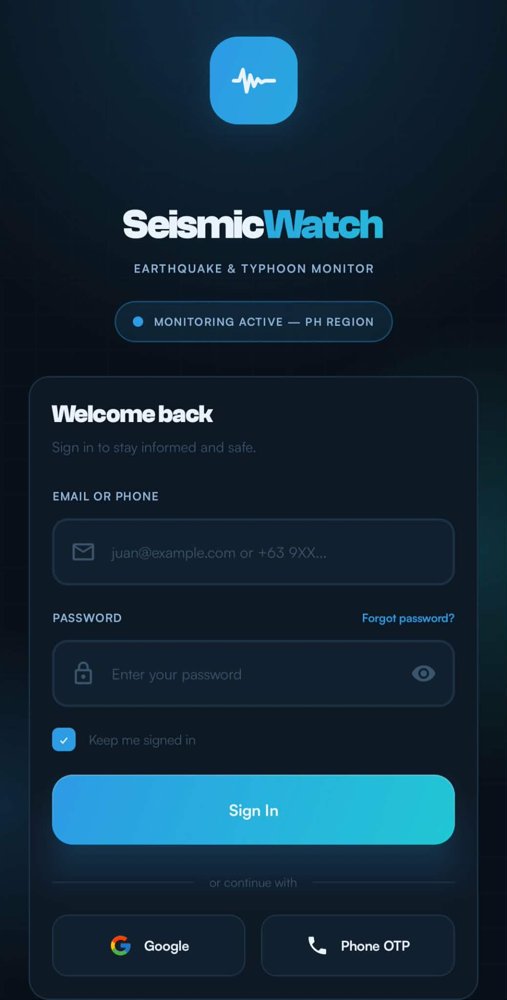 Authentication gate</td>
<td align="center">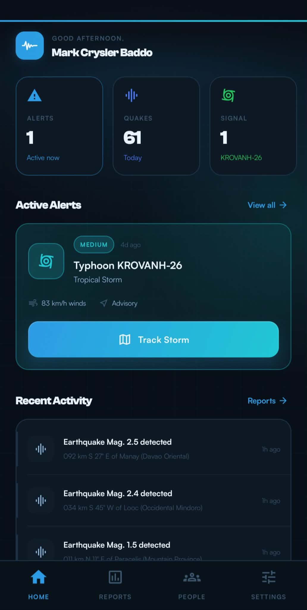 Command center</td>
</tr>
</table>

View all 14 screenshots

### 1. Authentication gate

### 2. Command center

### 3. Situational awareness map

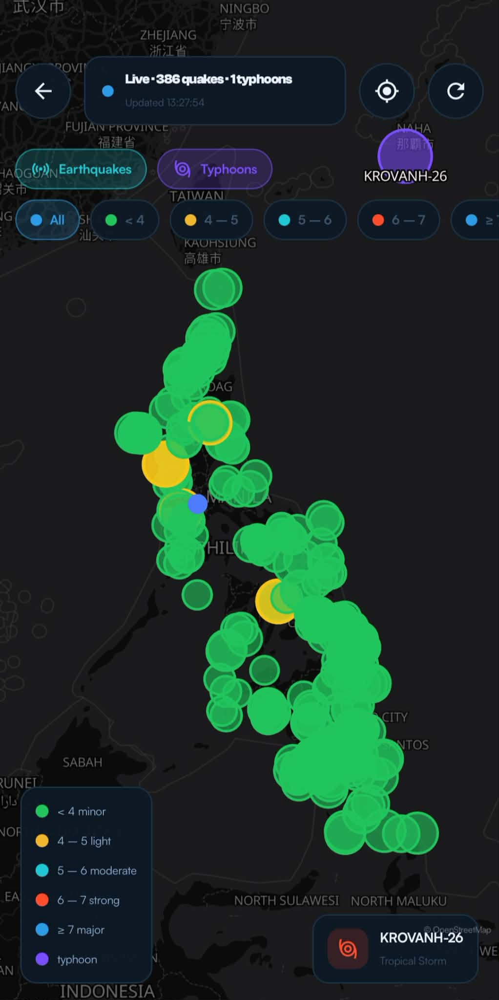

### 4. Typhoon tracking

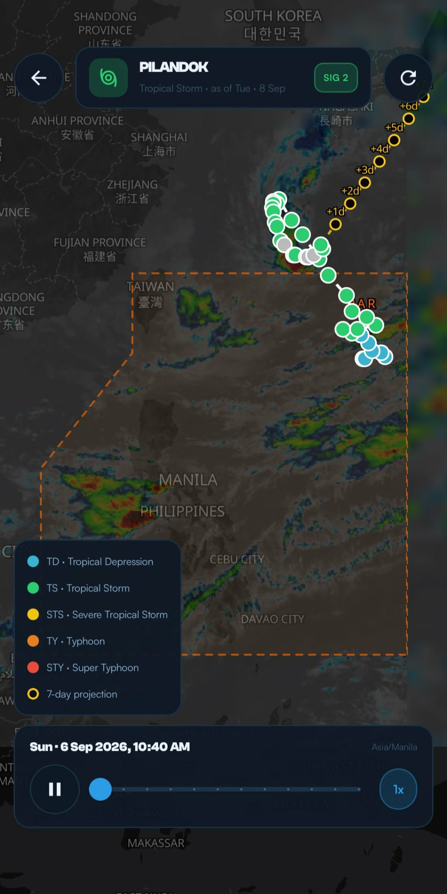

### 5. Post-quake assessment

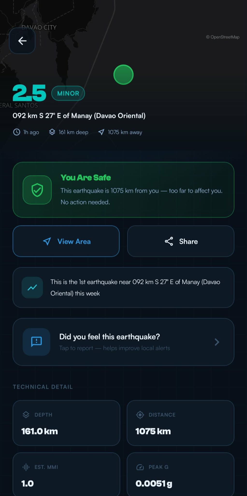

### 6. Earthquake archive

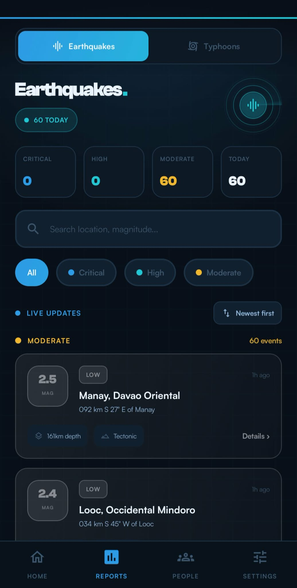

### 7. Typhoon archive

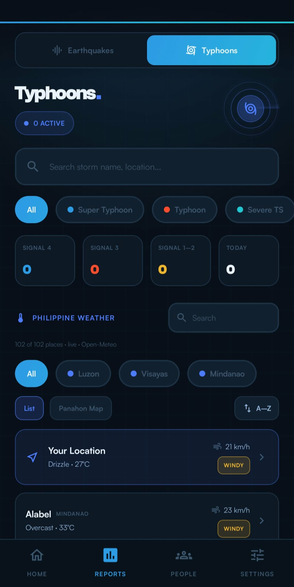

### 8. Emergency contacts

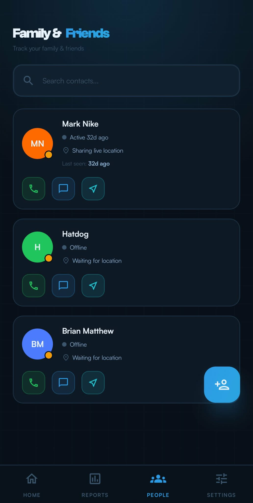

### 9. Live location sharing

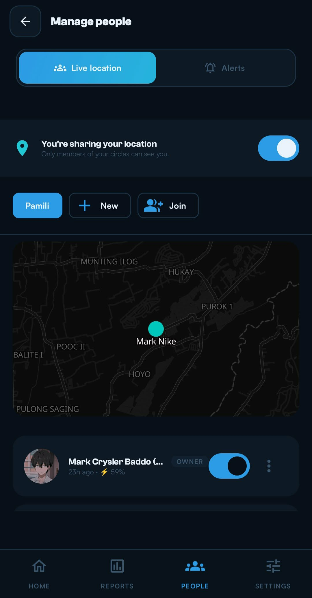

### 10. Automated alert rules

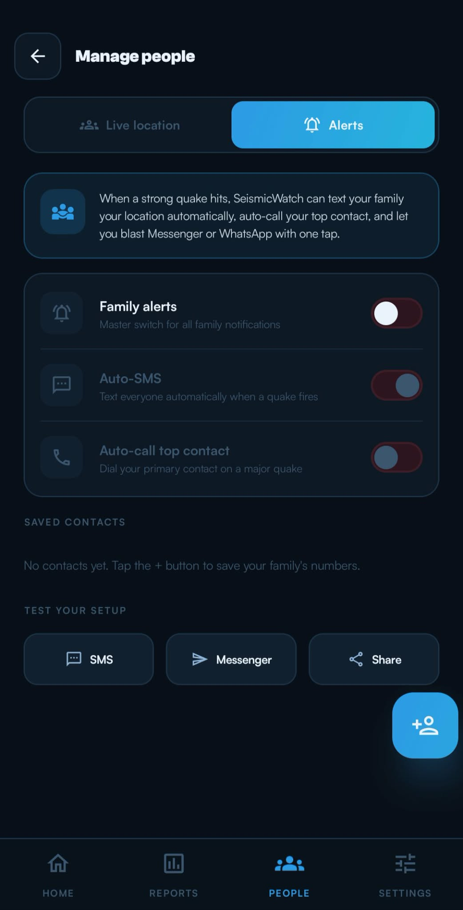

### 11. Notification preferences

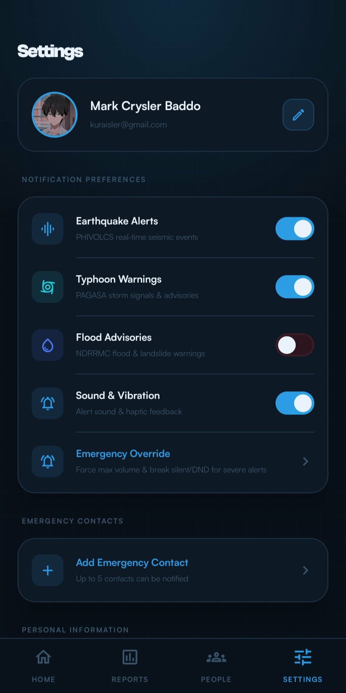

### 12. Profile & thresholds

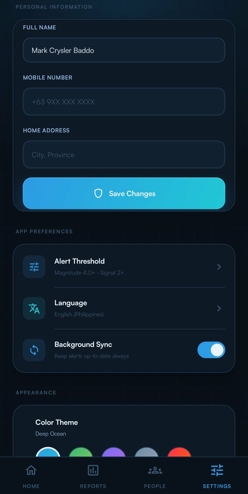

### 13. Safety tools configuration

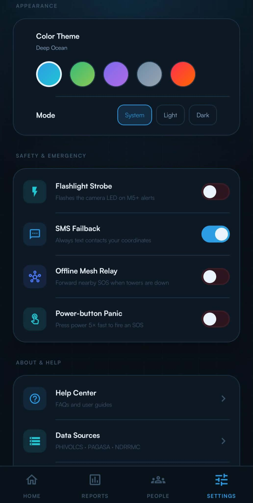

### 14. Transparency & support

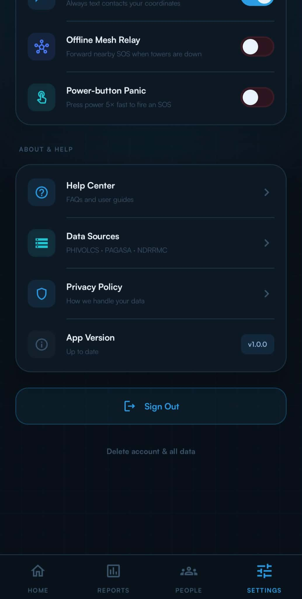

---

Project by [Mark Crysler Baddo](https://github.com/Kuraisura) · [Portfolio](https://kuraisler.xyz)
